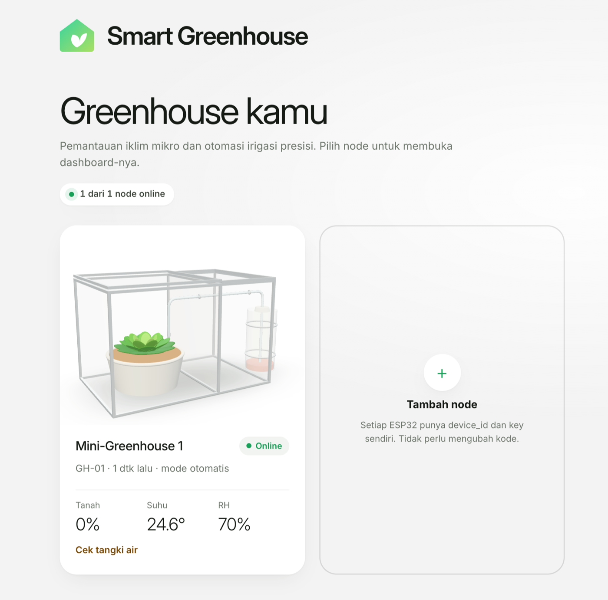
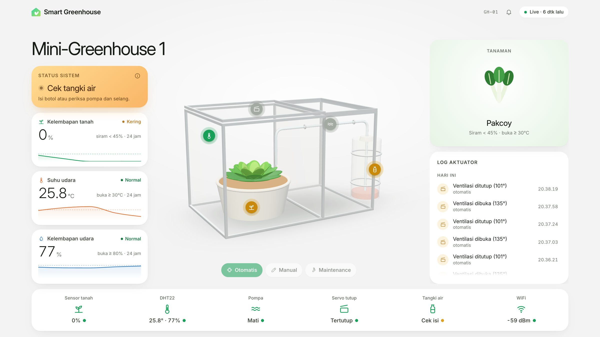
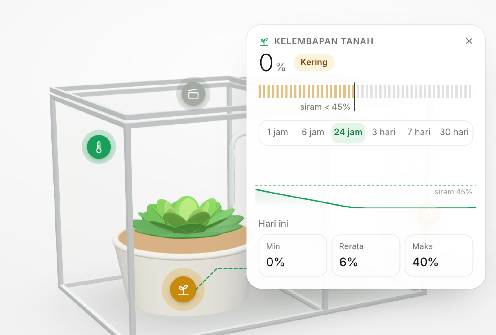
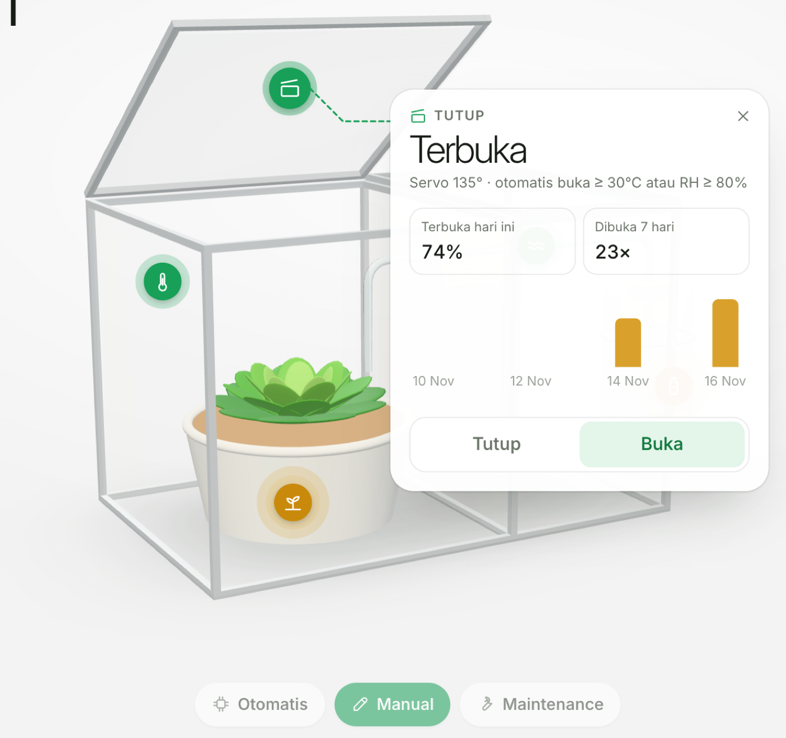
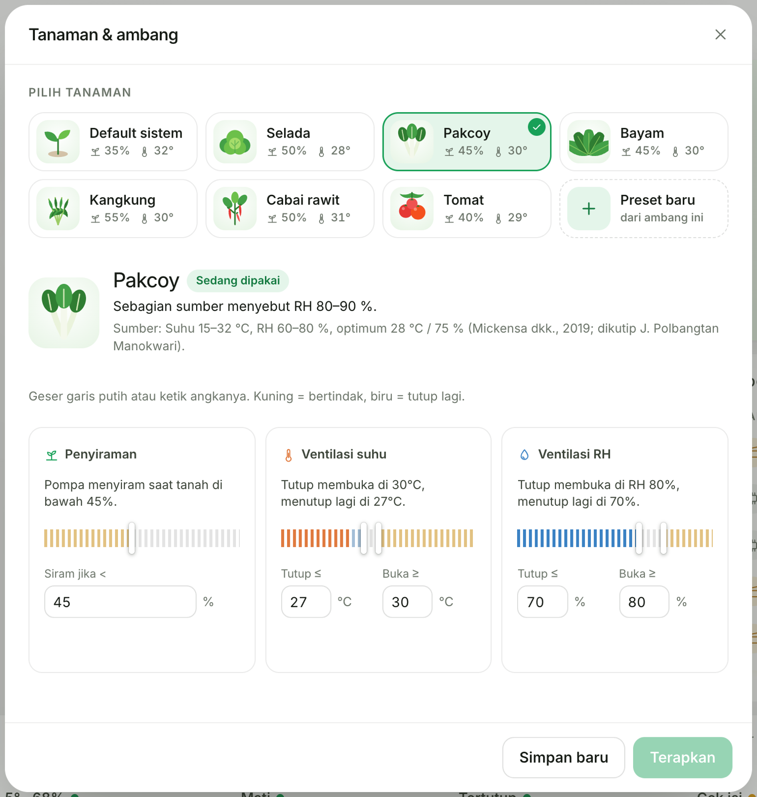
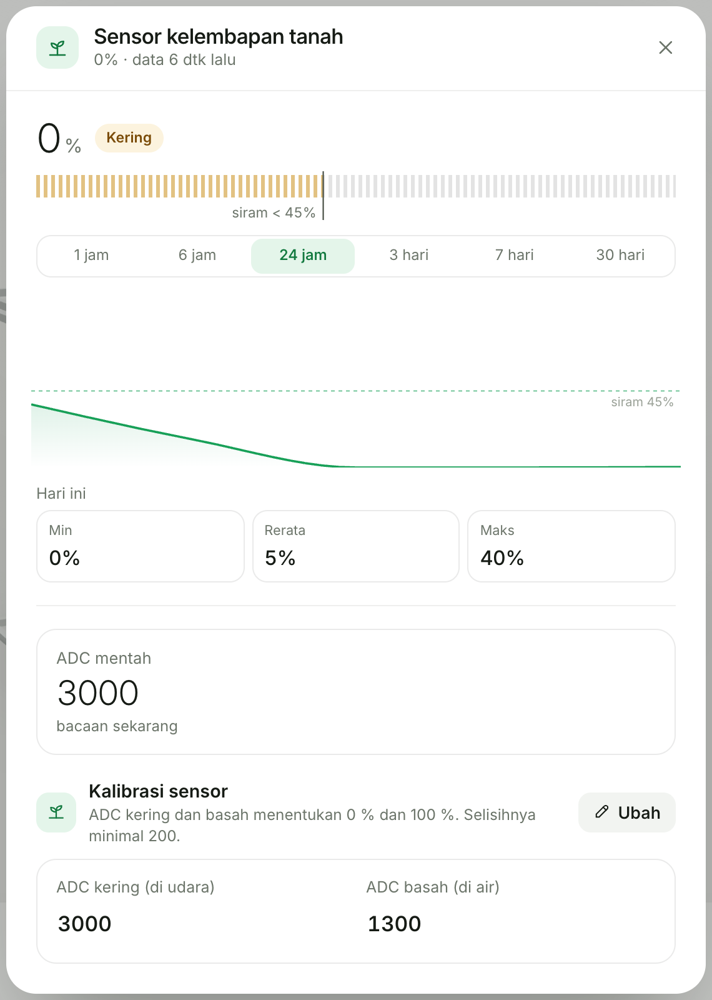
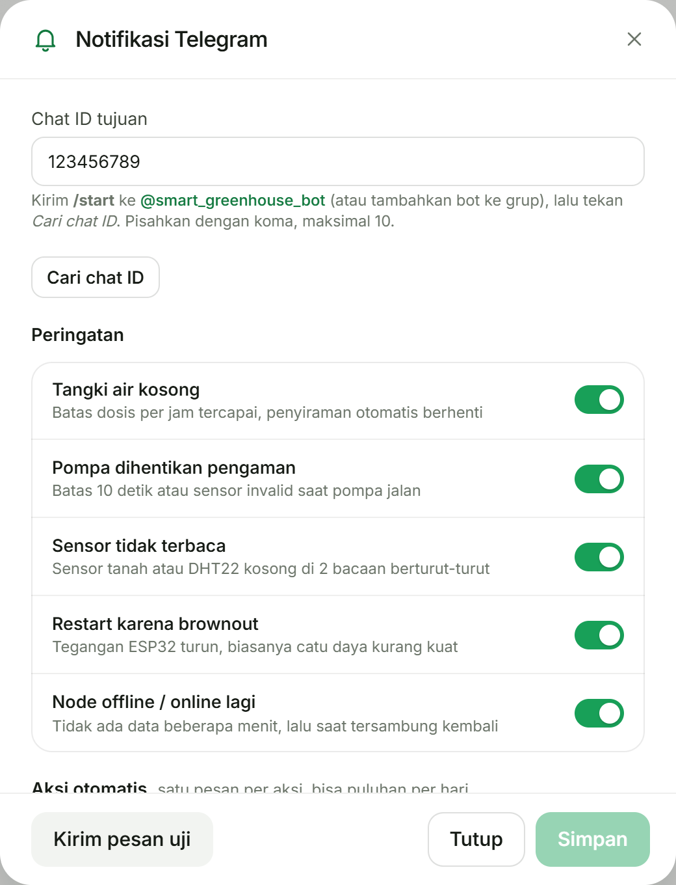

# Panduan Pengguna Dashboard

Untuk pemakai sehari-hari. Instalasi ada di [setup.md](setup.md), dan masalah umum di [troubleshooting.md](troubleshooting.md). Cara mengukur nilai kalibrasi ada di [hardware.md](hardware.md#urutan-tes), keselamatan di [safety.md](safety.md), dan referensi teknis di [api.md](api.md).

## Mulai cepat (5 langkah)

1. Buka alamat dashboard dan masuk dengan user dan password yang diberikan (kalau login diaktifkan).
2. Di halaman awal, pilih node (mis. *Mini-Greenhouse 1*). Titik hijau dan teks *Live* di pojok kanan atas berarti node mengirim data.
3. Pilih tanaman: tekan kartu **Tanaman** di kanan, pilih preset, lalu **Terapkan**.
4. Biarkan mode **Otomatis**. ESP32 menyiram dan membuka ventilasi sendiri sesuai ambang tanaman.
5. Cek kartu **Status Sistem** di kiri. Kalau hijau, tidak ada yang perlu dilakukan.

## Halaman daftar node

Menampilkan semua node beserta nilai terakhir dan status online. Tekan sebuah node untuk membuka dashboardnya. **Tambah node** membuat node baru; API key hanya ditampilkan sekali, jadi salin ke firmware (lihat [setup.md](setup.md#tambah-node-baru)). Logo di kiri atas selalu membawa Anda kembali ke daftar ini.

## Dashboard satu node

| Bagian | Isi |
|---|---|
| Navigasi atas | Logo, id node, tombol 🔔 (notifikasi Telegram), penanda *Live* atau *Offline* dengan umur data (*Live · MQTT* kalau data datang langsung lewat MQTT) |
| Kiri, **Status Sistem** | Satu-satunya kartu berwarna: hijau normal, kuning perlu perhatian, gelap offline. Ikon ⓘ menampilkan semua masalah dengan penjelasan lengkap |
| Kiri, tiga kartu sensor | Kelembapan tanah, suhu udara, kelembapan udara: nilai sekarang, ambang yang dipakai, dan grafik 24 jam |
| Tengah | Model 3D yang meniru kondisi alat (sudut tutup, warna tanah, aliran pompa, peringatan tangki). Tombol mode ada di bawahnya |
| Kanan | Kartu **Tanaman** dan **Log Aktuator** (setiap siram, buka/tutup, ganti mode, boot, dengan waktu dan pemicunya) |
| Bawah | Bar perangkat: sensor tanah, DHT22, pompa, servo tutup, tangki air, WiFi |

Kalau node offline, nilai sensor diredupkan dan umur data ditampilkan, karena bacaan terakhir bukan data langsung. ESP32 tetap mengatur penyiraman dan ventilasi sendiri saat offline.

## Mode kontrol

| Mode | Perilaku |
|---|---|
| **Otomatis** | ESP32 yang memutuskan: siram bila tanah lebih kering dari ambang, buka tutup bila suhu atau RH melewati ambang. Tombol siram dan tutup terkunci |
| **Manual** | Tombol *Siram* dan *Tutup/Buka* aktif. Otomatis tidak berjalan |
| **Maintenance** | Tutup terangkat penuh untuk akses ke tanaman; ventilasi otomatis dijeda. Berlaku di mode apa pun. Keluar dengan memilih mode lain. Penyiraman otomatis tetap bisa jalan, jadi lihat [safety.md](safety.md#bagian-bergerak) sebelum bekerja di dalam kotak |

Perintah dari web diambil ESP32 pada sync berikutnya (sekitar 3 detik). Perintah yang tidak terambil dalam 60 detik dibatalkan. Kalau ESP32 tidak mengonfirmasi perintah tutup dalam 25 detik, tampilan kembali ke posisi semula dan muncul pemberitahuan.

Untuk demo atau pemakaian normal, biarkan mode *Otomatis*.

## Titik info di model 3D

Titik di model (tanah, udara, pompa, tangki, tutup) membuka kartu detail saat ditekan. Tekan lagi atau tekan area kosong untuk menutup. Hanya satu kartu terbuka sekaligus.

Kartu tanah dan udara menampilkan nilai pada skala dengan ambang pemicu otomatis, riwayat (pilih 1 jam sampai 30 hari), dan min/rata-rata/maks hari ini. Kartu udara bisa berpindah antara suhu dan RH.

Kartu pompa menampilkan penyiraman 7 hari dan tombol *Siram*. Kartu tutup menampilkan persentase waktu terbuka 7 hari dan tombol *Tutup/Buka*. Keduanya abu-abu dan terkunci di mode Otomatis atau Maintenance; kartu menyediakan pintasan *Ke Manual*.

Rentang riwayat (1 jam sampai 30 hari) satu untuk semua: mengubahnya di satu kartu juga mengubah grafik di kartu kiri.

## Memilih tanaman dan ambang

1. Tekan kartu **Tanaman**.
2. Pilih preset (7 preset bawaan beserta sumbernya; preset bawaan hanya-baca).
3. Geser atau ketik tiga ambang: siram jika tanah di bawah, buka ventilasi pada suhu, dan buka ventilasi pada RH. Ambang buka harus lebih tinggi dari ambang tutupnya.
4. Tekan **Terapkan**. Nilai dikirim ke ESP32 pada sync berikutnya.

Preset custom bisa dibuat dan dihapus; preset hanya mengatur ambang yang bergantung pada tanaman, bukan kalibrasi alat.

## Kalibrasi alat

Tekan sebuah perangkat di bar bawah untuk membuka popup-nya: nilai, riwayat, analitik, dan kalibrasinya. Tekan **Ubah** untuk mengedit.

| Perangkat | Yang dikalibrasi |
|---|---|
| Sensor tanah | ADC kering (di udara) dan ADC basah (di air). Selisih minimal 200. Nilai ADC bacaan sekarang ditampilkan untuk membantu |
| Pompa | *Dosis pompa*: lama satu dosis, waktu meresap, debit pompa (ml/detik) |
| Servo tutup | Sudut tertutup, terbuka, dan maintenance (±1° atau ±5°) |
| Tangki air | *Stop rule*: batas dosis per jam sebelum pompa berhenti |
| WiFi | *Pengiriman data*: seberapa sering ESP32 mengirim bacaan |

Cara mengukur nilai awalnya ada di [hardware.md](hardware.md#urutan-tes).

## Notifikasi Telegram

Tombol 🔔 di navigasi membuka pengaturan per node: chat ID tujuan dan jenis pesan (tangki kosong, pompa dihentikan pengaman, sensor bermasalah, brownout, offline/online, siram otomatis, ventilasi otomatis). Cara menambah penerima: kirim `/start` ke bot dari akun Telegram penerima, tekan *Cari chat ID*, lalu *Pakai* dan *Simpan*. Tombol *Kirim pesan uji* memastikan tujuannya benar. Instalasi sisi server ada di [setup.md](setup.md#3-notifikasi-telegram-opsional).
## Arti status

| Status | Arti | Yang dilakukan |
|---|---|---|
| Cek tangki air | Batas dosis per jam tercapai tapi tanah masih kering | Isi botol, periksa pompa dan selang |
| Sensor tidak terbaca | Sensor tanah atau DHT22 tidak memberi nilai valid | Cek kabel sensor; penyiraman otomatis berhenti sampai sensor terbaca |
| Node offline | Tidak ada data lebih dari 30 detik | Cek WiFi dan daya node; kontrol otomatis tetap jalan di ESP32 |
| Tanah *Kering* | Di bawah ambang siram | Biasanya ditangani otomatis |

Kalau status tidak hilang atau alat tidak bereaksi: [troubleshooting.md](troubleshooting.md#penyiraman-dan-ventilasi-tidak-jalan).
